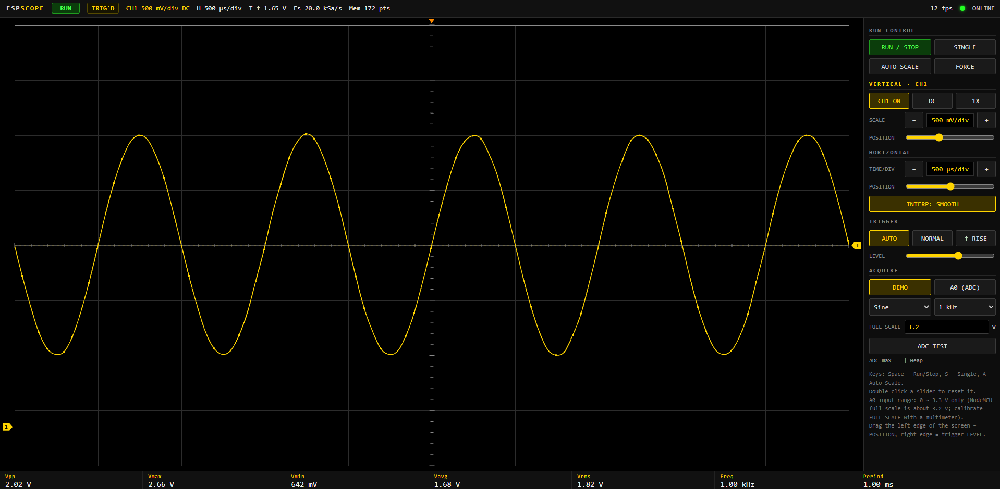
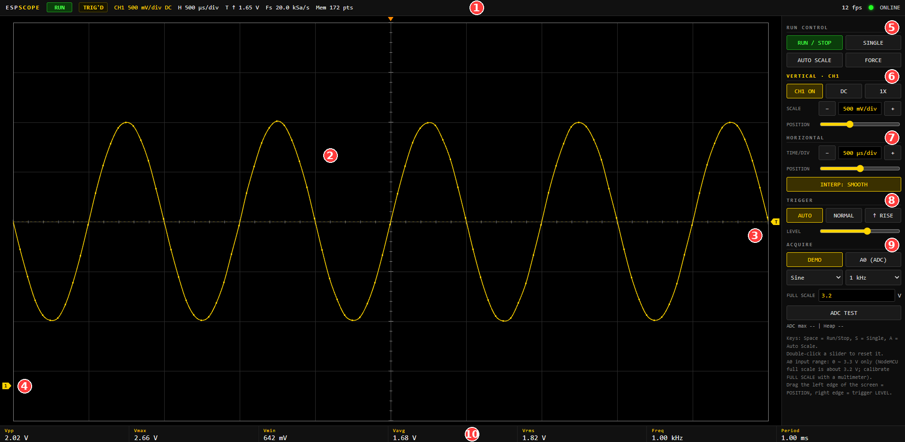
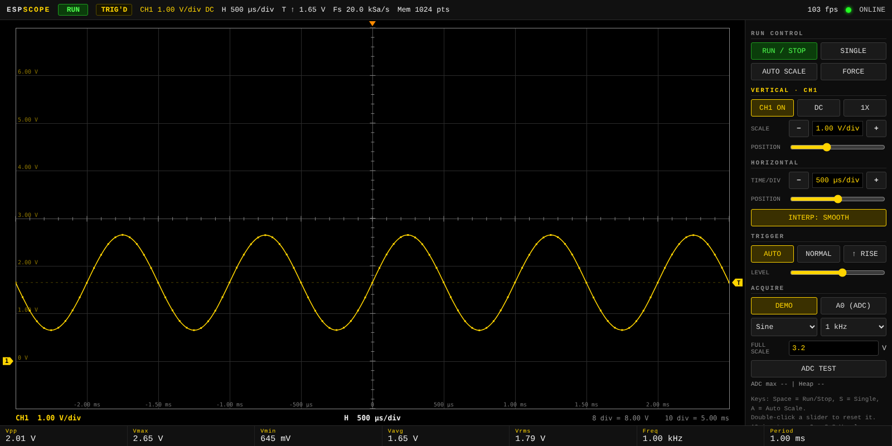
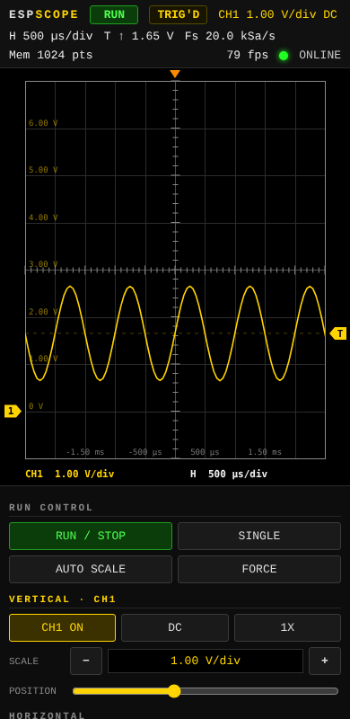
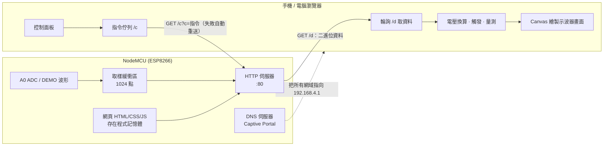
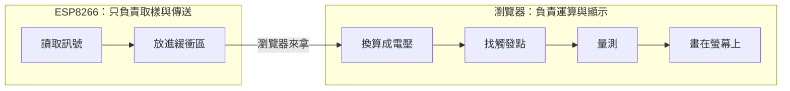
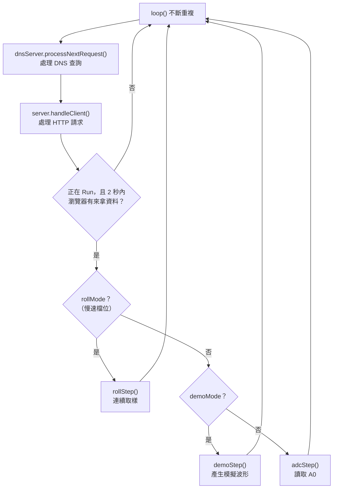
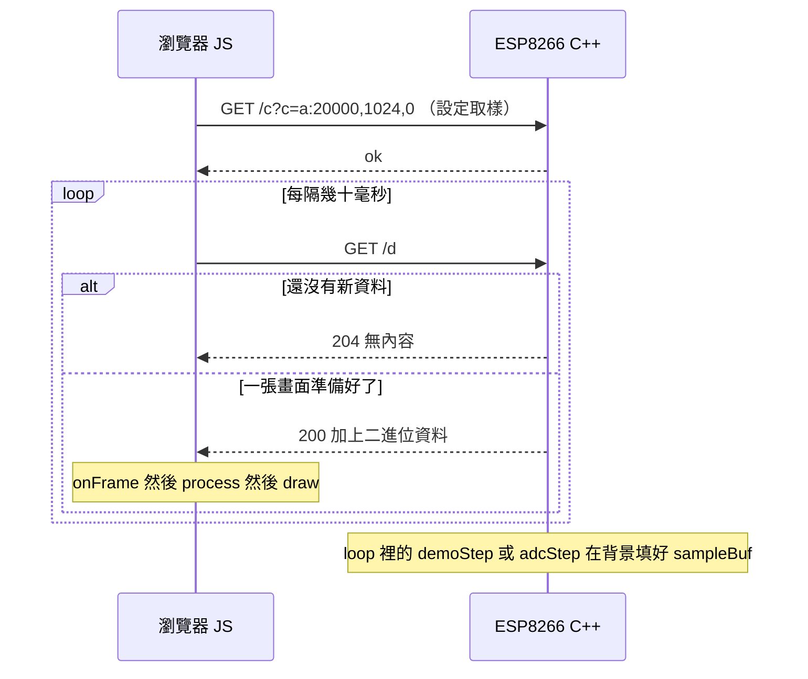

# ESP-Scope：用 NodeMCU 做的 WiFi 單通道示波器

> 沒有螢幕、沒有外接元件（最簡配置只要一塊 NodeMCU）。ESP8266 自己發出 WiFi 熱點，手機或電腦連上後會**自動彈出**示波器網頁，用瀏覽器看波形、調刻度、觸發與量測。



*上圖為 DEMO 模式（ESP 內部產生 1 kHz 正弦波）。頁首顯示 `12 fps`、`Fs 20.0 kSa/s`。*

---

## 目錄

1. [特色](#特色)
2. [畫面導覽](#畫面導覽)
3. [硬體與接線](#硬體與接線)
4. [快速開始](#快速開始)
5. [操作說明](#操作說明)
6. [取樣策略：不同 Time/div 怎麼取樣](#取樣策略不同-timediv-怎麼取樣)
7. [系統架構](#系統架構)
8. [程式架構（給初學者）](#程式架構給初學者)
9. [規格與限制](#規格與限制)
10. [校正](#校正)
11. [疑難排解](#疑難排解)
12. [版本沿革與後續規劃](#版本沿革與後續規劃)

---

## 特色

| 類別 | 內容 |
|---|---|
| **零外部函式庫** | 只用 ESP8266 核心內建的 `ESP8266WiFi`、`ESP8266WebServer`、`DNSServer`，單一 `.ino` 檔 |
| **離線可用** | 網頁（HTML/CSS/JS）全部放在 ESP 的程式記憶體裡，不需要網際網路、不用 CDN |
| **自動彈出** | 內建 Captive Portal，連上 WiFi 後系統會自動打開示波器頁面 |
| **示波器配色** | 黑底、10 × 8 格線、中心軸刻度、CH1 黃色波形，並標示「每格代表多少」 |
| **標準功能** | Run/Stop、Single、Force、Auto Scale、邊緣觸發（Auto/Normal）、水平/垂直刻度與位置、AC/DC 耦合、×1/×10 探棒 |
| **自動量測** | Vpp、Vmax、Vmin、Vavg、Vrms、頻率、週期 |
| **兩種資料源** | **DEMO**（ESP 內部模擬波形，用來確認網頁與連線）、**A0**（真實 ADC 輸入） |
| **隨刻度調整取樣** | 依 Time/div 自動決定取樣率與擷取長度；慢速檔位自動切換成 ROLL 連續捲動 |
| **手機也能用** | 版面會隨螢幕寬度調整 |

---

## 畫面導覽



| 編號 | 區域 | 說明 |
|---|---|---|
| ① | **狀態列** | 左起：Run 狀態（RUN / STOP / SINGLE）、觸發狀態、CH1 每格電壓、水平每格時間、觸發方向與準位、實際取樣率 `Fs`、記憶體深度 `Mem`；右側是更新率與連線燈號 |
| ② | **波形區** | 10 × 8 格線。左側與底部的小字是各格線代表的**電壓／時間**，底部的讀數列寫出**每格 V/div、s/div** |
| ③ | **觸發標記 `T`** | 黃色虛線與右側 `T` 標記是觸發準位；頂端橘色三角形是觸發時間點（水平位置） |
| ④ | **接地標記 `1`** | CH1 的 0 V 位置，用 POSITION 移動 |
| ⑤ | **RUN CONTROL** | Run/Stop、Single、Auto Scale、Force |
| ⑥ | **VERTICAL** | 通道開關、AC/DC、探棒倍率、V/div、垂直位置 |
| ⑦ | **HORIZONTAL** | Time/div、水平位置、波形插值（SMOOTH / LINEAR） |
| ⑧ | **TRIGGER** | Auto / Normal、上升/下降緣、準位 |
| ⑨ | **ACQUIRE** | 資料源（DEMO / A0）、模擬波形設定、FULL SCALE 校正、ADC TEST |
| ⑩ | **量測列** | Vpp、Vmax、Vmin、Vavg、Vrms、Freq、Period |

### 每格代表多少（新增的顯示）

新版在畫面上直接標示刻度，不必回頭看控制面板：



*此圖是用模擬資料在桌面瀏覽器渲染的前端畫面，用來示範刻度標示。*

- **左側黃色小字**：每條水平格線代表的電壓。會隨 V/div 與垂直位置變化。
- **底部灰色小字**：每條垂直格線相對於觸發點的時間（觸發點為 `0`）。ROLL 模式下以畫面右緣（現在）為 `0`。
- **最下方讀數列**：
  - 左：`CH1  1.00 V/div`（探棒 ×10 時會加註 `×10`）
  - 中：`H  500 µs/div`（ROLL 模式加註 `ROLL`）
  - 右：`8 div = 8.00 V　10 div = 5.00 ms`，即整個畫面的總電壓與總時間

手機畫面：



---

## 硬體與接線

最簡配置只需要 **NodeMCU（ESP-12E）**。真實訊號從 `A0` 腳輸入。

```
              NodeMCU
        ┌───────────────┐
        │               │
 訊號 ──┤ A0            │
 GND  ──┤ GND           │
        │         USB ──┼── 電腦（供電與上傳程式）
        └───────────────┘
```

> ⚠️ **輸入電壓只能是 0 ～ 3.3 V。**
> 不能量負電壓，也不能直接接大於 3.3 V 的訊號，否則可能燒毀 ADC。
> 要量更大電壓或有負電壓的訊號，需要自行加分壓與偏壓電路，並用二極體保護。
> 被量測的電路必須與 NodeMCU **共地**。

### 想量更大電壓：分壓前端（範例）

```
 訊號 ──[ R1 ]──┬── A0
                │
              [ R2 ]
                │
 GND ───────────┴────  GND
```

分壓後的電壓必須落在 0 ～ 3.3 V。此時把網頁上的探棒倍率切到 ×10，或用 FULL SCALE 校正讀數。（電阻值請依你的需求與負載自行選擇。）

---

## 快速開始

### 1. 準備 Arduino IDE

- 安裝 ESP8266 開發板支援，開發板選 **NodeMCU 1.0 (ESP-12E Module)**。
- 本程式**不需要安裝任何額外函式庫**。
- 建議把 ESP8266 核心升級到 3.x；本專案在 2.5.0 核心上也能編譯。

### 2. 上傳程式

1. 資料夾與檔名要一致：`esp8266_scope/esp8266_scope.ino`
2. 打開檔案，按「上傳」。
3. 序列埠監看視窗（115200）會印出 AP 啟動狀態。

### 3. 連線

1. 手機或電腦連上 WiFi **`ESP-Scope`**，密碼 **`12345678`**。
2. 系統通常會自動彈出示波器頁面。
3. 若沒有彈出，手動開啟 **http://192.168.4.1**。

> 想改 SSID 與密碼，修改 `.ino` 最上方的 `AP_SSID`、`AP_PASS`（密碼至少 8 個字元）。

### 4. 先用 DEMO 確認

預設是 DEMO 模式，ESP 會產生模擬波形。看到穩定的正弦波、各按鈕都有反應，代表 WiFi 與網頁都正常，再切到 **A0 (ADC)** 量真實訊號。

---

## 操作說明

### 控制項

| 功能 | 操作 |
|---|---|
| **Run / Stop** | 開始或暫停擷取 |
| **Single** | 武裝單次觸發，抓到一次觸發後停止，狀態列顯示 `DONE` |
| **Auto Scale** | 依目前訊號自動設定 Time/div、V/div、位置與觸發準位 |
| **Force** | 武裝後等不到觸發時，強制接受下一張畫面 |
| **CH1 ON/OFF** | 顯示或隱藏波形 |
| **DC / AC** | 耦合方式。AC 是在網頁端扣除平均值，不是硬體隔直流 |
| **1X / 10X** | 探棒倍率，顯示的電壓會乘上倍率 |
| **SCALE － ＋** | 垂直 V/div（10 mV ～ 5 V，1-2-5 序列） |
| **TIME/DIV － ＋** | 水平 Time/div（100 µs ～ 200 ms，1-2-5 序列） |
| **POSITION** | 垂直位置、水平位置（觸發點在畫面中的位置） |
| **Auto / Normal** | Auto：沒有觸發也會更新畫面。Normal：沒有觸發就不更新 |
| **↑ RISE / ↓ FALL** | 上升緣或下降緣觸發 |
| **LEVEL** | 觸發準位 |
| **INTERP** | SMOOTH 用平滑曲線連接取樣點，LINEAR 為原始點連線 |
| **ADC TEST** | 實測 A0 最高讀取速度與剩餘記憶體，並自動限制 Time/div |

### 快捷鍵與滑鼠

- `Space`：Run / Stop
- `S`：Single
- `A`：Auto Scale
- 拖曳波形區**左邊緣**：調整垂直位置；拖曳**右邊緣**：調整觸發準位
- 滑桿雙擊：恢復預設值

### Single 的使用提示

- 狀態列顯示 `ARMED`：正在等待觸發。
- 顯示 `ARMED LVL?`：觸發準位不在目前訊號的最小～最大值之間，永遠不會觸發，請調整 LEVEL。
- 等不到觸發時可按 **FORCE**。
- 慢速（ROLL）檔位沒有觸發，Single 的行為是「收滿一個畫面就停止」。

---

## 取樣策略：不同 Time/div 怎麼取樣

ESP8266 的 ADC 速度與記憶體都有限，所以取樣率與擷取長度會**隨 Time/div 自動調整**，不是固定值：

| Time/div | 模式 | 每格取樣點數 | 擷取方式 |
|---|---|---|---|
| 較快（< 20 ms） | 觸發擷取（Auto） | 約 80 點 | 只擷取「一個畫面加上觸發餘裕」的長度，不是整個緩衝區 |
| 較快（< 20 ms） | 觸發擷取（Normal / Single） | 約 50 點 | 使用整個 1024 點緩衝區，觸發搜尋範圍更寬 |
| 較慢（≥ 20 ms） | **ROLL** 連續捲動 | 約 50 點 | ESP 連續取樣到環形緩衝區，網頁依時間平滑捲動，沒有觸發 |

- 取樣率上限：DEMO 為 20 kSa/s；A0 預設 8 kSa/s，按 **ADC TEST** 後改用實測值。
- 取樣率 ≥ 3500 Sa/s 時，A0 用「連續短 burst」讀取，取樣間隔較準，但每次最多約 0.3 秒不處理 WiFi。
- 頁首的 `Fs` 顯示的是**實際量到**的取樣率，時間軸都以它為準。
- 記憶體深度：每次最多 1024 點，每點存成 16 bit。

---

## 系統架構



### 通訊協定

| 路徑 | 內容 |
|---|---|
| `GET /` | 示波器網頁 |
| `GET /d` | 資料。200：二進位資料；204：目前沒有新資料。回應標頭 `X-Run`、`X-Cfg` 帶 ESP 目前狀態，網頁發現與期望不同會自動補送指令 |
| `GET /c?c=<指令>` | 控制指令：`run`、`stop`、`a:<取樣率>,<長度>,<roll>`、`src:demo` / `src:adc`、`wave:`、`freq:`、`bench` |

資料封包格式（little-endian）：

```
[uint32 取樣率 fs][uint32 meta：0 = 完整畫面，1 = ROLL 片段][n × uint16 原始 ADC 值]
```

### 為什麼用 HTTP 輪詢，不用 WebSocket？

本專案早期用 WebSocket，但不同電腦裝的函式庫版本常互相衝突（例如多個函式庫都附帶自己的 `WebSocketsServer`，在舊核心上編譯失敗）。改成 HTTP 輪詢後：

- 完全不需要外部函式庫。
- 在舊與新的 ESP8266 核心都能編譯。
- 代價是更新率較低（DEMO 實測約 12 fps）。

---

## 程式架構（給初學者）

這一章帶你從「整體概念」一路看到「想改東西該改哪裡」。建議照順序讀。

### 1. 先建立整體概念

整個專案只有一個 `.ino` 檔，但裡面其實藏著**兩個程式**：

| | 韌體（C++） | 網頁（HTML + CSS + JavaScript） |
|---|---|---|
| 在哪裡執行 | **ESP8266** 上 | **手機或電腦的瀏覽器**裡 |
| 程式碼在哪 | `.ino` 檔案的大部分區域 | 一大段文字 `INDEX_HTML`（`R"=====(` 到 `)====="` 之間） |
| 負責什麼 | 發 WiFi、讀取訊號、回應瀏覽器 | 換算電壓、找觸發點、量測、畫示波器畫面、處理按鈕 |

ESP 對網頁只做一件事：瀏覽器來要的時候，**原封不動把那段文字送出去**。ESP 自己不會執行它。

**為什麼這樣分工？** ESP8266 的運算力和記憶體很小，而手機、電腦的瀏覽器很強。所以 ESP 只做「取樣與傳送」，繁重的計算和繪圖都交給瀏覽器。

**另一個重要原則：瀏覽器主動來拿，ESP 不主動推。** 瀏覽器每隔一小段時間問 ESP：「有新資料嗎？」，有就拿走，沒有就等下一次。



### 2. `.ino` 檔案由上到下的內容

| 順序 | 區塊 | 內容 |
|---|---|---|
| 1 | 檔頭註解 | 專案說明與通訊協定摘要 |
| 2 | `#include` | 引入內建函式庫：WiFi、網頁伺服器、DNS 伺服器 |
| 3 | `user settings` | 可調整的設定：`AP_SSID`、`AP_PASS`、`AP_CHANNEL`、`N_SAMPLES`（每次取樣點數）、取樣率上限 |
| 4 | `globals` | 全域變數：伺服器物件、取樣緩衝區、各種狀態旗標 |
| 5 | `INDEX_HTML` | **網頁本體**，檔案中最長的一段。裡面又分 `<style>`（CSS 外觀）、HTML 結構、`<script>`（JavaScript 邏輯） |
| 6 | 擷取狀態與工具函式 | 擷取相關變數、`storeFrame()` 等 |
| 7 | demo signal | `waveAt()`、`toRaw()`、`demoStep()`：產生模擬波形 |
| 8 | roll mode | `rollStep()`：慢速檔位的連續取樣 |
| 9 | real ADC | `adcBurst()`、`adcStep()`：讀取真實 A0 |
| 10 | commands | `resetAcq()`、`applyCmd()`：解讀瀏覽器傳來的指令 |
| 11 | http | `handleRoot()`、`handleData()`、`handleCmd()`、`handleNotFound()`：回應各個網址 |
| 12 | `setup()` / `loop()` | 程式的起點與主迴圈 |

> **Arduino 的規則**：`setup()` 在開機時執行**一次**，`loop()` 之後**不斷重複執行**。

### 3. 韌體的運作：`setup()` 與 `loop()`

**`setup()` 做的事（只跑一次）：**

1. 開啟序列埠（115200），把 CPU 設成 160 MHz。
2. 把 ESP 設成 **WiFi AP 模式**，IP 固定為 `192.168.4.1`。
3. 登記網址對應的處理函式：
   - `/` → `handleRoot()`（送出示波器網頁）
   - `/d` → `handleData()`（給資料）
   - `/c` → `handleCmd()`（收指令）
   - 其他任何網址 → `handleNotFound()`（導回示波器頁面，這是自動彈出的關鍵）
4. 啟動 HTTP 伺服器（連接埠 80）與 DNS 伺服器（連接埠 53）。

**`loop()` 做的事（不斷重複）：**



> **`loop()` 要跑得快。** ESP8266 的 WiFi 要靠 `loop()` 一直有空檔才能運作，所以程式盡量不長時間卡住。唯一的例外是 A0 的 burst 擷取，每次最多阻塞約 0.3 秒。

### 4. 韌體的重要變數

| 變數 | 意義 |
|---|---|
| `sampleBuf` | **取樣緩衝區**：存放 1024 個取樣值（`uint16_t`） |
| `txBuf` | **傳送緩衝區**：前面 8 個位元組是檔頭（取樣率、類型），後面是資料 |
| `frameReady` | 旗標：`true` 代表有一張新畫面等著被瀏覽器取走 |
| `running` | 目前是 Run（`true`）還是 Stop（`false`） |
| `demoMode` | `true` 為模擬波形，`false` 為真實 A0 |
| `fsReq` | 瀏覽器要求的取樣率 |
| `capLen` | 瀏覽器要求的「每張畫面要擷取幾點」 |
| `rollMode` | 是否為慢速連續捲動模式 |
| `lastPollMs` | 瀏覽器上一次來拿資料的時間，超過 2 秒沒來，ESP 就暫停取樣省資源 |

### 5. 網頁（前端）的結構

網頁的 JavaScript 放在 `<script>` 裡，由上到下分成幾個區塊：

| 區塊 | 主要函式 | 說明 |
|---|---|---|
| 常數與狀態 | `st` 物件 | 儲存所有設定（見下表） |
| 格式化 | `eng()` | 把數字轉成 `500 mV`、`1.5 kHz` 這種工程單位 |
| 取樣設定 | `expectedFs()`、`expectedLen()`、`isRoll()`、`trigWide()` | 依 Time/div 決定要向 ESP 要求的取樣率與長度 |
| 通訊 | `send()`、`pump()`、`syncState()`、`poll()`、`onFrame()` | 指令佇列、定時輪詢、收資料 |
| ROLL 模式 | `pushRoll()`、`processRoll()`、`tick()` | 慢速檔位的平滑捲動 |
| 訊號處理 | `toVolts()`、`findTrigger()`、`measure()`、`process()` | 數值換算、找觸發點、計算 Vpp/頻率等 |
| 更新介面 | `updateMeas()`、`updateHeader()`、`updateControls()` | 把狀態顯示到文字與按鈕上 |
| 繪圖 | `layout()`、`draw()` | 在 Canvas 上畫格線、波形、刻度與標記 |
| 控制 | `setRun()`、`autoScale()`、`onV()`、`onT()`、各按鈕的事件 | 處理使用者操作 |

**`st` 物件：前端的「設定總表」**

| 欄位 | 意義 |
|---|---|
| `run` | `'run'`、`'stop'` 或 `'single'` |
| `trigMode` | `'auto'` 或 `'normal'` |
| `slope` | 觸發方向（`1` 上升、`-1` 下降） |
| `trigV` | 觸發準位（伏特） |
| `vIdx`、`tIdx` | 目前選到第幾檔 V/div、Time/div（對應 `VDIVS`、`TDIVS` 陣列） |
| `pos`、`hpos` | 垂直位置、水平位置 |
| `cpl`、`probe` | 耦合方式（DC/AC）、探棒倍率 |
| `src` | 資料來源（`'demo'` 或 `'adc'`） |

**前端的核心做法：**畫面完全由 `st`（設定）加上最近收到的資料決定。使用者改任何設定，流程都是：

> 改 `st` → 呼叫 `refresh()` 重新處理資料 → `draw()` 重畫畫面

所以你想知道「為什麼畫面長這樣」，只要看 `st` 的內容與 `draw()` 即可。

### 6. 一張畫面的旅程（資料如何流動）



逐步說明：

1. **ESP 取樣**：`loop()` 呼叫 `demoStep()` 或 `adcStep()`，把取樣值填進 `sampleBuf`。
2. **打包**：`storeFrame()` 把取樣率、類型與取樣值複製到 `txBuf`，並設 `frameReady = true`。
3. **瀏覽器來拿**：`poll()` 向 `/d` 要資料。有新畫面時 `handleData()` 回傳 `txBuf`，沒有就回 204。
4. **解析**：`onFrame()` 把收到的位元組還原成數字陣列。
5. **換算**：`toVolts()` 把 0 ～ 1023 的原始值換成電壓（乘上滿量程與探棒倍率，AC 耦合則扣掉平均值）。
6. **找觸發點**：`findTrigger()` 在資料中找出訊號穿過觸發準位的位置，決定波形從哪裡開始畫。
7. **量測**：`measure()` 算出 Vpp、Vmax、Vmin、Vavg、Vrms 與頻率。
8. **畫圖**：`draw()` 畫出格線、波形、刻度與標記。

### 7. 範例：按下 Time/div 的「＋」會發生什麼事？

1. `onT(1)` 被呼叫，`st.tIdx` 加 1。
2. `clampT()` 確認這一檔沒有超出 ADC 能做到的範圍。
3. `modeSwitch()` 判斷是否跨越了「觸發擷取」與「ROLL」的界線，必要時清掉舊資料。
4. `sendFs()` 算出新的取樣率與擷取長度，用 `send('a:取樣率,長度,roll')` 放進指令佇列。
5. `pump()` 透過 `GET /c?c=...` 把指令送給 ESP；失敗會自動重送。
6. ESP 的 `handleCmd()` 呼叫 `applyCmd()`，更新 `fsReq`、`capLen`、`rollMode`，並用 `resetAcq()` 清掉舊的擷取。
7. 下一張畫面就以新的取樣率送回來，`process()` 與 `draw()` 依新的 Time/div 重畫。同時 `updateControls()` 更新面板上的數字。

### 8. 想修改？從哪裡下手

| 想做的事 | 修改位置 |
|---|---|
| 改 WiFi 名稱與密碼 | `.ino` 上方的 `AP_SSID`、`AP_PASS` |
| 改慢速（ROLL）的切換門檻 | JavaScript 的 `ROLL_MIN_T`（`0.02` 代表 20 ms/div） |
| 改每格取樣點數 | JavaScript 的 `PTS`、`PTS_ROLL`、`PTS_TRIG` |
| 增減 V/div、Time/div 檔位 | JavaScript 的 `VDIVS`、`TDIVS` 陣列 |
| 改 A0 滿量程預設值 | JavaScript 的 `vrefAdc`（預設 `3.2`） |
| 改 A0 取樣率上限 | 按 ADC TEST 會自動更新；預設值在 `.ino` 的 `fsMaxAdc` 與 JavaScript 的 `FS_MAX` |
| 改波形顏色 | CSS 與 `draw()` 裡的 `#ffd400`（黃色），可用編輯器的「取代」一次改完 |
| 改版面與按鈕 | `INDEX_HTML` 內的 HTML 與 CSS |
| 新增一個控制指令 | 前端用 `send('指令')`，在 `.ino` 的 `applyCmd()` 加一個對應的判斷 |
| 加大取樣點數 | 改 `N_SAMPLES`，並同步修改 JavaScript `expectedLen()` 裡的 `1024`。要留意 ESP8266 的記憶體有限，點數太大可能不穩定 |

> 修改 `INDEX_HTML` 時要小心：它是 C++ 的一個長字串，內容不能出現 `)=====";` 這串字元，否則會提早結束。

### 9. 建議的閱讀順序

1. `setup()` 與 `loop()`：看懂程式的骨架。
2. `handleData()` 與 `handleCmd()`：看懂瀏覽器如何跟 ESP 溝通。
3. `demoStep()`：看懂取樣值怎麼被產生。
4. 網頁的 `poll()` 與 `onFrame()`，再看 `process()`：看懂資料如何被處理。
5. `draw()`：看懂畫面如何被畫出來。

### 10. 名詞小辭典

| 名詞 | 意思 |
|---|---|
| **AP（Access Point）** | ESP 自己當 WiFi 基地台，讓手機、電腦連進來 |
| **輪詢（Polling）** | 用戶端每隔一段時間主動去問「有新資料嗎？」 |
| **緩衝區（Buffer）** | 暫時存放資料的記憶體空間 |
| **取樣率（Fs）** | 每秒讀取幾次訊號，單位 Sa/s |
| **ADC** | 類比數位轉換器，把電壓轉成數字（本專案是 0 ～ 1023） |
| **Captive Portal** | 連上 WiFi 後自動彈出登入頁的機制，這裡用來自動開啟示波器 |
| **Canvas** | 瀏覽器內可以用程式畫圖的區域，示波器畫面就畫在上面 |
| **觸發（Trigger）** | 讓每次畫面的波形都從相同位置開始，看起來才會穩定 |

---

## 規格與限制

| 項目 | 說明 |
|---|---|
| 通道數 | 1（ESP8266 只有一個 ADC 腳） |
| 解析度 | 10 bit |
| 輸入範圍 | 0 ～ 3.3 V（NodeMCU 板載分壓） |
| 取樣率 | 受 `analogRead` 速度限制；A0 單通道約 10 kSa/s 的量級，**實際值請用 ADC TEST 量測** |
| 可用頻寬 | 低頻範圍。要讓波形看起來像樣，一個週期至少需要 5 ～ 10 個點，所以大約是**數 kHz 以下**（估算值，請以你的實測為準） |
| 記憶體深度 | 每次 1024 點 |
| 水平刻度 | 100 µs ～ 200 ms / div |
| 垂直刻度 | 10 mV ～ 5 V / div |

### 已知限制

- **WiFi 會干擾 ADC**：讀值可能有幾 LSB 的跳動，這是 ESP8266 的特性。
- **觸發在瀏覽器端判斷**：ESP 兩次擷取之間有「死區時間」，很短、只出現一次的事件仍可能漏掉。
- **混疊**：訊號頻率超過取樣率的一半時，畫面會顯示成較低的頻率。SMOOTH 插值只是畫面重建，不會增加真實資訊。
- **耦合方式**：AC 耦合是軟體扣平均值，輸入端仍是直流耦合。
- 不適合量 MHz 等級的數位訊號。

---

## 校正

NodeMCU 的 A0 滿量程大約是 **3.2 V**（不一定剛好 3.3 V），每塊板子略有差異。

1. 用 A0 接一個已知電壓（例如用三用電表量過的電池或穩壓輸出）。
2. 在 ACQUIRE 區的 **FULL SCALE** 欄位輸入數值，直到示波器讀數與三用電表一致。
3. 設定會存在這個瀏覽器中。

---

## 疑難排解

| 現象 | 處理方式 |
|---|---|
| 編譯錯誤：`'class WiFiServer' has no member named 'accept'`，且路徑含 `Petal_IoT_Cloud` | 舊版程式用到 WebSocket 函式庫，被其他函式庫的同名檔案搶先使用。使用現在的版本（不依賴 WebSocket）即可 |
| 編譯錯誤：找不到 `LittleFS.h`，路徑含 `LittleFSExplorer` | sketch 開頭多了 `#include <LittleFSExplorer.h>`，刪掉它；本程式不需要 |
| 連上 WiFi 後沒有自動彈出網頁 | 手動輸入 `http://192.168.4.1`；iPhone 建議在彈出的小視窗中改用 Safari 開啟；關閉行動數據再試 |
| 手機提示「無法連上網際網路」 | 選擇保持連線 |
| 畫面顯示 `CONNECTING TO SCOPE...` | 確認仍連在 `ESP-Scope`，重新整理網頁 |
| Single 一直 `ARMED` | 看是否顯示 `LVL?`，調整觸發準位；或按 FORCE |
| 狀態列出現紅色 `OVER` | A0 讀值達到上限，輸入電壓超過量測範圍 |
| A0 讀值與三用電表不一致 | 調整 FULL SCALE |
| A0 沒接東西時波形亂跳 | 浮接的 A0 會讀到雜訊，屬正常現象 |

---

## 版本沿革與後續規劃

### 已完成

- WiFi AP + 網頁前端、Captive Portal 自動彈出
- 黑底示波器介面、單通道、量測
- 真實 ADC 接入、ADC TEST、FULL SCALE 校正、OVER 警示
- 依 Time/div 調整取樣率與擷取長度、慢速 ROLL 模式與平滑捲動
- Single 穩定性修正：指令佇列與重送、狀態同步、較寬的觸發搜尋範圍、Force
- 畫面標示每格電壓與時間

### 可能的後續方向

- **觸發移到 ESP 端**：持續取樣加預觸發緩衝，解決死區時間，真正抓到單次事件
- **多通道**：外接 SPI ADC（如 MCP3008 / MCP3208）以取得更高取樣率與多個通道
- 游標量測（ΔT、ΔV、1/ΔT）、Zoom、FFT、XY 模式
- 匯出 CSV 與 PNG
- 同時支援 STA 模式（連家裡的路由器）

---

## 授權與聲明

個人學習專案。量測任何電路前請確認電壓在安全範圍內；使用本專案造成的任何損壞，由使用者自行負責。
